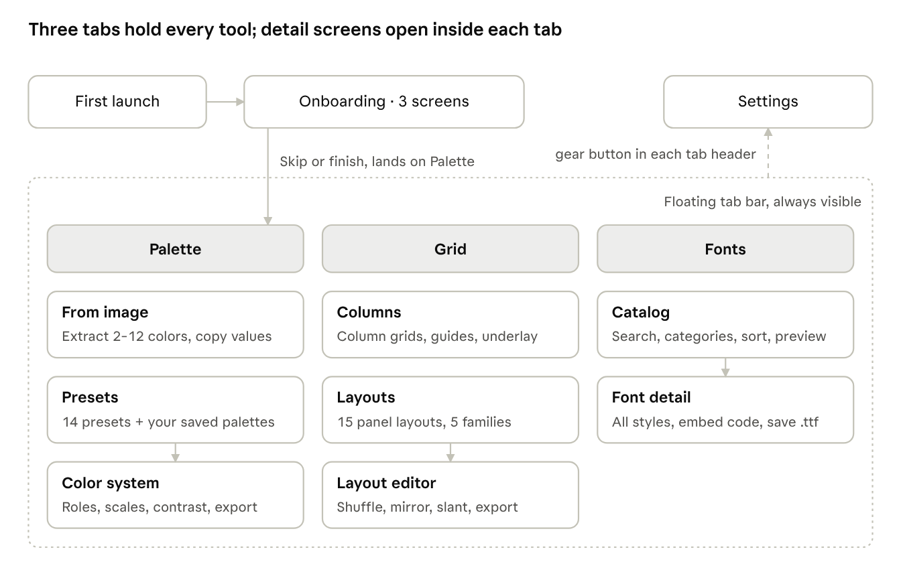
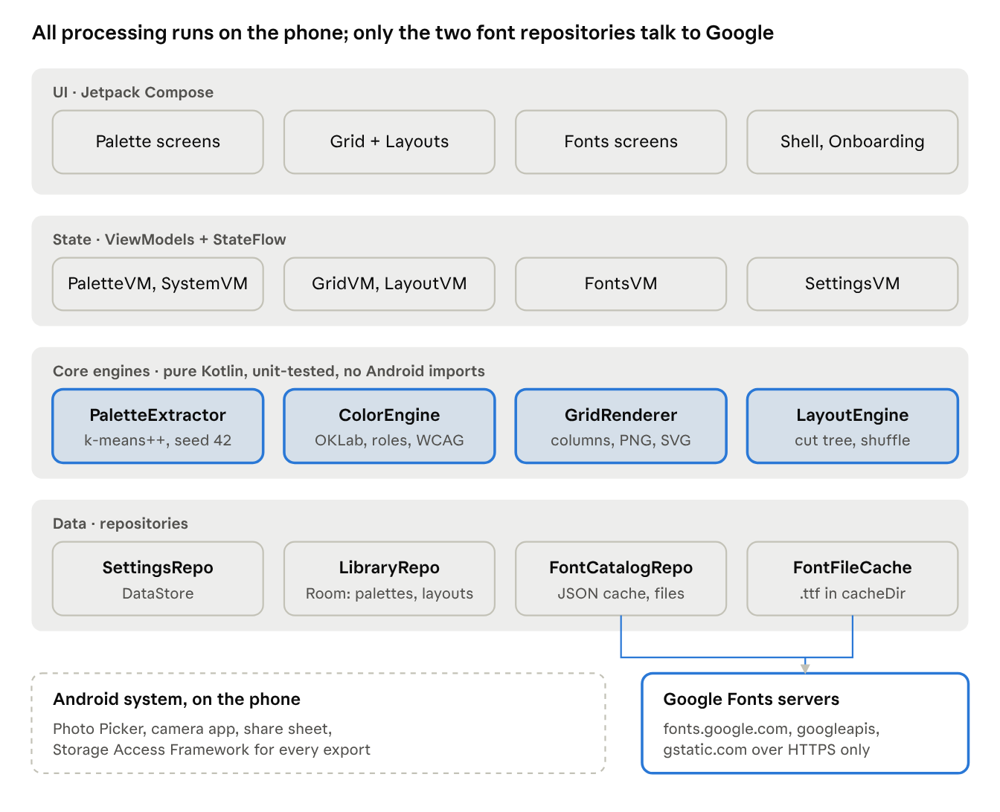
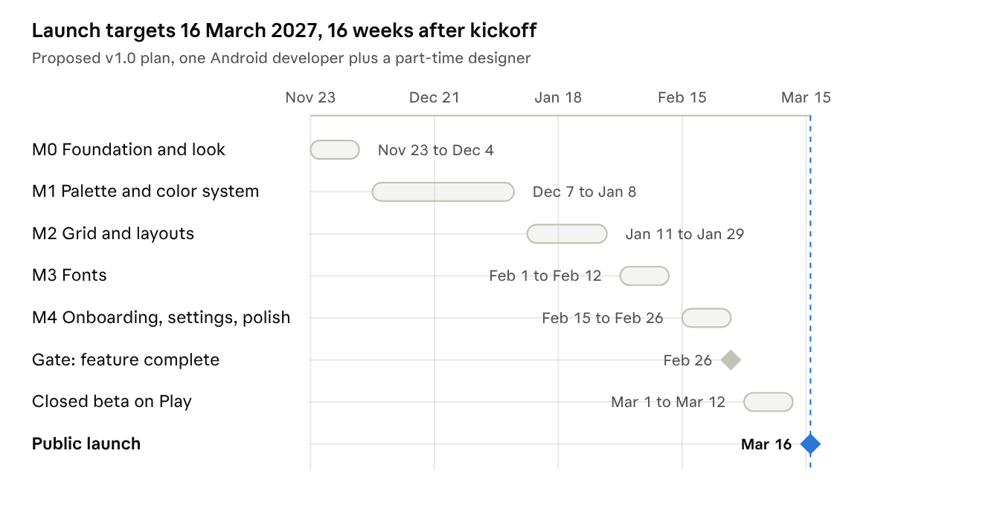

# Palettez — Product Requirements (v1.0)

Nov 20, 2026 · Owner: @Fritz Boadwoh-Donkor · Status: Draft for review

## Summary

Palettez is a free, local-first Android app that gives designers four everyday tools in one place: a color palette extractor, preset color systems, layout grids with panel layouts, and a Google Fonts browser. v1.0 targets a public Google Play release about 16 weeks after kickoff (proposed: kickoff 23 Nov 2026, launch mid-March 2027).

**Problem.** Designers working on a phone juggle three or four apps for color, grids and type. Most are ad-funded, need an account, upload photos to a server, or lock CMYK values, export or presets behind a subscription. Font apps rarely show newly released Google Fonts.

**Product promise.** Colors, grids and type, free on your phone. No account, no ads, no tracking. Images never leave the device; the only network traffic is to Google Fonts.

### Goals

1.  Turn any photo into a usable palette with HEX, RGB, CMYK and HSL values in under 2 seconds, on-device.

2.  Turn any palette, extracted or preset, into a working color system: roles, 10-step scales, harmonies, contrast grades and code export.

3.  Generate column grids and panel layouts for social, slides, web and print, exported as PNG, SVG or CSS, plus on-device layout analysis for uploaded posters and flyers.

4.  Browse the full, always-current Google Fonts catalog, preview any text, discover font pairings, copy embed code and save font files.

5.  Export presentation-ready brand identity cards in 16:9 and 1:1 aspect ratios with multi-color-space readouts (HEX, RGB, CMYK, HSL, OKLab) and WCAG validation.

6.  Ship a distinctive, accessible interface: the bold look on the canvas, WCAG 2.2 AA throughout.

### Non-goals for v1.0

- iOS, tablet-optimised layouts, or a web version.

- Accounts, cloud sync, sharing to a community, or any server of our own.

- Editing images, drawing, or a full design editor.

- Paid tiers, ads or in-app purchases.

- Non-Google font sources or uploading custom fonts.

### How we will know it works

The app collects no analytics, so success is measured from Google Play Console and opt-in feedback only.

| Measure                                               | Target at 90 days after launch               | Source                                       |
|-------------------------------------------------------|----------------------------------------------|----------------------------------------------|
| User-perceived crash-free rate                        | 99.5% or higher                              | Play Console vitals                          |
| User-perceived ANR rate                               | Below 0.47% (Play's bad-behaviour threshold) | Play Console vitals                          |
| Store rating                                          | 4.5 or higher                                | Play Console                                 |
| Palette extraction time, 12 MP photo, mid-range phone | Under 2 s                                    | Internal benchmark                           |
| Cold start to first screen                            | Under 1.5 s on a 2021 mid-range phone        | Macrobenchmark                               |
| Accessibility audit                                   | No open AA failures                          | Accessibility Scanner + manual TalkBack pass |

## Users and use cases

The primary user is a working designer who often decides colors, grids and type away from a laptop. Three personas cover v1.0.

| Persona                   | Who                                                                    | Main jobs in Palettez                                                                     | What they need most                                  |
|---------------------------|------------------------------------------------------------------------|-------------------------------------------------------------------------------------------|------------------------------------------------------|
| Freelance social designer | Makes posts, carousels and stories for small brands, mostly on a phone | Pull a palette from a client's photo; build a 4:5 or 9:16 grid; find a headline font      | Fast extraction, social presets, one-tap copy of HEX |
| Brand and print designer  | Builds identities, menus, flyers; hands files to printers              | Get CMYK values; check contrast; export a color system to developers; A4 and Letter grids | CMYK, contrast grades, PNG/SVG export, font files    |
| Comic and zine maker      | Lays out pages and panels, often by hand first                         | Try panel layouts; shuffle new ones; mirror and slant; export a page template             | Panel layouts, Shuffle, print sizes                  |

### Key use cases

1.  A designer photographs a market stall, gets six colors with coverage percentages and copies the CMYK values for a printer.

2.  A designer opens the Market day preset, swaps the primary role, checks that button text passes AA, and copies a Tailwind config to a developer.

3.  A designer picks Instagram portrait, sets 6 columns with a 24 px gutter, and saves a PNG to overlay in their editing app.

4.  A comic maker opens Layouts, filters Slants, mirrors Rush, sets an A4 page and saves an SVG template.

5.  A designer searches "grotesk", previews a client's tagline in each result, and saves the regular and bold .ttf files.

6.  A designer shares a photo from Google Photos straight into Palettez and lands on the Palette tab with the colors extracted.

## Scope

v1.0 ships every screen on the design canvas. Anything not on the canvas waits for a later release.

| Area                     | In v1.0                                                                                                                        | Later (v1.1+)                                                   |
|--------------------------|--------------------------------------------------------------------------------------------------------------------------------|-----------------------------------------------------------------|
| Onboarding               | 3 intro screens, theme choice, Skip                                                                                            | Contextual tips on first use of each tool                       |
| Palette from image       | Photo picker, camera, share-to-app, 2–12 colors, 3 sort orders, HEX/RGB/CMYK/HSL copy, PNG export                              | Eyedropper on the image, palette from a screenshot of a website |
| Presets and color system | 14 built-in presets in 6 moods, saved palettes, roles, 10-step scales, harmonies, contrast, CSS/Tailwind/JSON export           | Adobe .ase and Procreate .swatches export, "use as app theme"   |
| Grid: columns            | 10 presets + custom size, columns, rows, gutter, baseline, margins, guides, image underlay, PNG/SVG/CSS                        | Units in pt and mm, saved grid presets                          |
| Grid: panel layouts      | 15 layouts in 5 families, Shuffle, mirror, slant, gutter, margin, 5 page sizes, 3 styles, PNG/SVG                              | Drag to resize panels, multi-page export to PDF                 |
| Fonts                    | Full Google Fonts catalog, search, 6 categories, 3 sorts, NEW tag, preview text and size, all styles, copy link/CSS, save .ttf | Pairing suggestions, compare two fonts side by side             |
| Settings                 | Theme, default color count, copy format, remember grid, font refresh, NEW window, clear saved fonts, privacy, licenses         | Backup and restore of saved palettes                            |
| Platforms                | Android 8.0+ phones                                                                                                            | Tablets and foldables, iOS                                      |

## Design language

The app uses the "Bold edition" look from the design canvas: a warm cream ground, tall condensed headlines, bold color-block cards and a floating black pill tab bar. It replaces stock Material 3 styling; Material 3 Compose components are used underneath and restyled with these tokens. Source of truth for every screen: [Design Kit – Android screens](https://claude.ai/artifact/H3aU5sdMJQaUaUZatzTqNQ).

### Color tokens

| Token     | Light    | Dark     | Use                                       |
|-----------|----------|----------|-------------------------------------------|
| ground    | \#EFE9DF | \#1D2320 | Screen background                         |
| surface   | \#FBF8F3 | \#2A312D | Cards, chips, inputs                      |
| ink       | \#151515 | \#FFFFFF | Primary text, tab bar, primary buttons    |
| ink-muted | \#5E584F | \#C9CEC9 | Secondary text (5.1:1 on ground in light) |
| line      | \#D7CFC2 | \#343C37 | Outlines, dividers, inactive switch track |
| grape     | \#6A58CC | \#6A58CC | Block color, white text                   |
| mustard   | \#F4C542 | \#F4C542 | Block color, ink text                     |
| coral     | \#E2603F | \#E2603F | Block color, ink text, error              |
| sage      | \#4E7A5B | \#4E7A5B | Block color, white text                   |
| sky       | \#AFCBEA | \#AFCBEA | Preview stages, ink text                  |
| lime      | \#A7D86E | \#A7D86E | Main call to action, success, ink text    |
| deep      | \#1D2320 | \#11150F | Detail pages, code blocks, privacy card   |

Dark mode uses the Dark column exactly as listed; a design pass in M4 only checks contrast, it does not re-pick colors. Rule: text on a block color is ink or white, whichever gives the higher contrast; the app computes this at runtime for user colors.

### Type

All three families are open source (SIL Open Font License) and bundled in the APK, so the interface never needs the network.

| Style    | Font               | Size / line height        | Use                                            |
|----------|--------------------|---------------------------|------------------------------------------------|
| Display  | Anton 400          | 52 / 56 sp                | Screen titles (PALETTE, GRID, FONTS, SETTINGS) |
| Headline | Anton 400          | 34–40 / 40–44 sp          | Detail titles, HEX codes on swatch cards       |
| Section  | Anton 400          | 22–26 / 28–32 sp          | Section labels (SWATCHES, ROLES)               |
| Button   | Anton 400          | 22 / 28 sp, +0.6 tracking | Main call-to-action pills                      |
| Body     | Figtree 500        | 15–16 / 22–23 sp          | Paragraphs, list rows                          |
| Label    | Figtree 600–700    | 13–15 / 18–20 sp          | Chips, tab bar, card names                     |
| Caption  | Figtree 400–500    | 12 / 17 sp                | Hints, metadata                                |
| Value    | JetBrains Mono 500 | 11–12 / 16 sp             | HEX, RGB, CMYK, code                           |

### Shape and spacing

- Spacing scale: 4, 6, 8, 10, 12, 14, 16, 20, 24 dp. Screen padding 20 dp; gap between sections 16 dp.

- Radius: cards 22–28 dp, preview stages 28 dp, inputs 20 dp, pills fully rounded, icon buttons circular.

- Touch targets: 48 dp minimum on Android (the canvas mock-ups draw 44 px; build to 48 dp).

- Elevation: none on cards; one soft shadow only on the floating tab bar, toasts and preview pages.

### Core components

| Component             | Spec                                                                                                                                                  |
|-----------------------|-------------------------------------------------------------------------------------------------------------------------------------------------------|
| Floating tab bar      | Ink pill, 64 dp tall, 6 dp padding, centered 22 dp above the bottom inset; active tab = surface pill with icon + label; inactive = 52 dp icon circles |
| Screen header         | Caption line + Display title, optional 52 dp circle actions at right                                                                                  |
| Mode switch           | Surface track, two equal segments, active segment ink with white label (From image / Presets, Columns / Layouts)                                      |
| Choice chips          | 44–48 dp pills; selected = ink fill, white label; unselected = surface fill                                                                           |
| Stepper tile          | Surface card: label, Anton value, minus (outlined circle) and plus (ink circle)                                                                       |
| Swatch card           | Full card in the color, Anton HEX, coverage pill, value pills that copy on tap                                                                        |
| Primary CTA           | Lime pill, Anton label, ink text; secondary CTA = ink pill, white text                                                                                |
| Toast                 | Surface pill above the tab bar, 1.8 s; on dark screens ink pill                                                                                       |
| Bottom sheet / detail | Deep background with a colored hero block (font detail)                                                                                               |

### Motion

- Standard transitions 200 ms, sheets and page pushes 300 ms, emphasized easing.

- Palette re-sort and grid preview changes animate positions over 200 ms.

- Shuffle cross-fades the old and new layout over 250 ms.

- All motion respects the system "Remove animations" setting.

## Information architecture

The app has three top-level tabs in a floating tab bar. Each tab has a mode switch or a list that opens one detail screen; nothing is more than two taps from a tab.

navigation map · 3 tabs, 9 screens, onboarding and settings

Onboarding shows once, on first launch, and can be replayed from Settings. Back always returns to the previous screen; the system back gesture on a tab root exits the app. Each tab keeps its own back stack and scroll position when the user switches tabs.

| Entry point                     | Lands on                                 |
|---------------------------------|------------------------------------------|
| Launcher icon, first launch     | Onboarding: Welcome                      |
| Launcher icon, later launches   | Last open tab (default Palette)          |
| Share an image from another app | Palette → From image, extraction started |
| Settings → Replay the intro     | Onboarding: Welcome                      |

## Feature requirements

Each requirement has an ID for tickets and tests. "Done when" is the acceptance test QA runs on a real device.

### 1. Onboarding

Three screens on first launch: Welcome, Colors from any photo, Grids and every Google Font.

| ID   | Requirement                                                                     | Done when                                    |
|------|---------------------------------------------------------------------------------|----------------------------------------------|
| ON-1 | Show onboarding only on first launch; store a onboardingDone flag               | Second launch opens the last tab directly    |
| ON-2 | Skip on screen 1 and Back on screens 2–3; step dots show 1 of 3, 2 of 3, 3 of 3 | TalkBack reads "Step 2 of 3"                 |
| ON-3 | Screen 3 offers Light / Dark / System; the choice is saved to Settings          | Theme applies immediately on Start designing |
| ON-4 | Screen 2 states that images never leave the phone                               | Copy matches the canvas                      |
| ON-5 | Replay the intro from Settings                                                  | Replay ends back on Settings                 |

### 2. Palette from image

The user picks or shoots an image and gets 2–12 dominant colors, each with coverage %, HEX, RGB, CMYK and HSL.

| ID    | Requirement                                                                                                         | Done when                                               |
|-------|---------------------------------------------------------------------------------------------------------------------|---------------------------------------------------------|
| PA-1  | Pick an image with the Android Photo Picker (no storage permission)                                                 | No permission prompt appears on Android 8–15            |
| PA-2  | Take a photo with the system camera app via TakePicture into app cache; no CAMERA permission declared               | Works with no camera permission in the manifest         |
| PA-3  | Accept ACTION_SEND image/\* from other apps and open Palette → From image                                           | Sharing from Google Photos extracts colors              |
| PA-4  | Extract colors on-device with k-means++ (see Architecture); default count from Settings (6)                         | 12 MP photo extracts in under 2 s on a mid-range phone  |
| PA-5  | Same image and count always give the same colors (fixed seed)                                                       | Repeat extraction gives identical HEX codes             |
| PA-6  | Count slider 2–12; order: Most used, Light to dark, By hue                                                          | Re-sort completes in under 100 ms without re-extracting |
| PA-7  | Each swatch card shows the color, Anton HEX, coverage %, and RGB, CMYK, HSL pills; text is ink or white by contrast | Every label passes 4.5:1 on its swatch                  |
| PA-8  | Tapping any value copies it; a toast confirms "Copied …"; tapping the swatch copies the format chosen in Settings   | Clipboard holds the exact string shown                  |
| PA-9  | Copy all HEX, copy CSS variables, copy full list, save palette PNG (1200 px wide, one 150 px row per color)         | PNG saves through the system file picker                |
| PA-10 | Save the extracted palette to Your palettes with the image name and date                                            | It appears first in Presets → Your palettes             |
| PA-11 | CMYK uses the standard device-independent formula and the UI says so                                                | Note visible under the swatches                         |

### 3. Presets and color system

Any palette, preset or extracted, opens as a color system: live preview, roles, scales, harmonies, contrast and export.

| ID    | Requirement                                                                                                                                                                                                                                  | Done when                                               |
|-------|----------------------------------------------------------------------------------------------------------------------------------------------------------------------------------------------------------------------------------------------|---------------------------------------------------------|
| CS-1  | Ship 14 presets in 6 moods (Earthy, Warm, Cool, Pastel, Bold, Neutral) plus the Palettez house palette, as JSON in assets                                                                                                                    | All presets match the canvas reference sheet            |
| CS-2  | Presets tab lists Your palettes first, then presets filtered by mood; each card shows colors, HEX, mood and the text-on-background grade                                                                                                     | Mood chip filters in under 100 ms                       |
| CS-3  | Auto-assign 5 roles: background (lightest), text (darkest, or ink/white if under 7:1), primary (most colorful with 3:1 on background), secondary (next), accent (hue furthest from primary, not reusing primary or secondary when avoidable) | Unit tests cover all 15 palettes                        |
| CS-4  | Change cycles a role through the palette colors (text and background also offer ink and white); Auto-assign resets                                                                                                                           | Preview updates in the same frame                       |
| CS-5  | Live preview card renders background, text, primary button (ink or white label), secondary button and accent badge                                                                                                                           | Matches the canvas preview                              |
| CS-6  | 10-step scale (50–900) per color, 500 = the color; tints mix toward white and shades toward black in OKLab at 92/82/64/44/22% and 15/32/50/66%                                                                                               | Golden-file test for \#E4572E gives \#FFF2EF … \#310C04 |
| CS-7  | Harmonies for the selected color: complementary, analogous (±30°), triadic, split (180±30°), same saturation and lightness                                                                                                                   | Tap copies each color                                   |
| CS-8  | Contrast checks for 5 pairings with ratio and grade (AAA ≥ 7, AA ≥ 4.5, AA Large ≥ 3, Fail) using the WCAG 2.2 formula                                                                                                                       | Ratios match WebAIM's checker to 0.1                    |
| CS-9  | Export CSS variables, Tailwind config and JSON tokens, containing roles and all scales; Copy code and Share                                                                                                                                  | Pasted CSS parses with no errors                        |
| CS-10 | Save a preset with edited roles as a new palette in Your palettes                                                                                                                                                                            | Survives app restart                                    |

### 4. Grid: columns

Column and row grids for any canvas size, drawn live and exported at full resolution.

| ID   | Requirement                                                                                                                                                                                                                              | Done when                                                 |
|------|------------------------------------------------------------------------------------------------------------------------------------------------------------------------------------------------------------------------------------------|-----------------------------------------------------------|
| GR-1 | Size presets: Square 1080×1080, Portrait 1080×1350, Story 1080×1920, Slide 1920×1080, Desktop 1440×900, Phone 390×844, A4 and A4 landscape at 300 dpi, US Letter at 300 dpi, Poster 18×24 in at 150 dpi; plus custom 16–4096 px per side | Custom values outside the range are clamped, not rejected |
| GR-2 | Steppers for columns (0–24), rows (0–24), gutter (0–200, step 4), margins (0–400, step 10, all sides or per side), baseline (0–64, step 4), fill opacity (0–60%, step 5)                                                                 | Every change redraws the preview within one frame         |
| GR-3 | Guides: center lines, rule of thirds, transparent background                                                                                                                                                                             | Each toggle shows in preview and exports                  |
| GR-4 | Grid color from 4 presets plus the colors of the last palette                                                                                                                                                                            | Palette colors appear after an extraction                 |
| GR-5 | Optional image underlay with "match canvas to image size"                                                                                                                                                                                | A 4000 px photo underlays without running out of memory   |
| GR-6 | Summary line: size, column width, row height, and a warning when margins or gutters leave no room                                                                                                                                        | Warning shows for 24 columns with a 200 px gutter         |
| GR-7 | Export PNG at full size, SVG with named groups (grid, margins, baseline), and copy CSS grid                                                                                                                                              | SVG opens in Figma and Illustrator with groups intact     |
| GR-8 | Remember the last grid between launches when Settings allows                                                                                                                                                                             | Grid restores after a restart                             |

### 5. Grid: panel layouts

Page layouts for comics, collages, moodboards and carousels, built from one rule: every cut runs edge to edge, so every panel stays four-sided.

| ID   | Requirement                                                                                                                                                                                                    | Done when                                 |
|------|----------------------------------------------------------------------------------------------------------------------------------------------------------------------------------------------------------------|-------------------------------------------|
| LA-1 | 15 layouts in 5 families: Classic (Tiers, Hero base, Brick), Stacks (Tall left, Triptych, Ladder), Slants (Tilt, Wedge, Rush), Insets (Spotlight, Corner pop, Center stage), Mosaic (Spiral, Off-grid, Window) | All 15 match the canvas reference sheet   |
| LA-2 | Gallery with family filter and three looks: Paper, Ink, Palette (panels filled with palette colors)                                                                                                            | Look switch redraws all thumbnails        |
| LA-3 | Editor: page size 3:4, 4:5, 1:1, 9:16, A4; gutter 0–80; margin 0–160; slant strength 0–200%; mirror left-right and top-bottom                                                                                  | Every control redraws live                |
| LA-4 | Shuffle generates a new layout from the rules: 2–3 cuts per level, alternating direction, ratios 0.6–1.5, 45% slant chance per cut, 20% inset chance, 4–9 panels                                               | 1,000 seeds all produce 4–9 valid panels  |
| LA-5 | A seed always produces the same layout; the seed is shown ("Shuffle \#4096")                                                                                                                                   | Re-entering a seed restores the layout    |
| LA-6 | Insets draw a ring one gutter wide around the floating panel                                                                                                                                                   | Ring visible at every gutter size above 0 |
| LA-7 | Export PNG at the page size (A4 at 2480×3508) and SVG with one polygon per panel                                                                                                                               | SVG panels are separate, editable shapes  |
| LA-8 | Save a layout (template or shuffled, with its settings) to a Saved list                                                                                                                                        | Survives restart                          |

### 6. Fonts

The full Google Fonts catalog, refreshed automatically, with previews in each font.

| ID   | Requirement                                                                                                                                                     | Done when                                                          |
|------|-----------------------------------------------------------------------------------------------------------------------------------------------------------------|--------------------------------------------------------------------|
| FO-1 | Fetch the catalog from fonts.google.com/metadata/fonts (family, category, styles, popularity, dateAdded) on open when Settings allows; cache the last good copy | Works offline with the cached list                                 |
| FO-2 | Search by name or category word; filter All, Sans, Serif, Display, Handwriting, Mono; sort New, Popular, A–Z                                                    | Search returns in under 150 ms over the full list                  |
| FO-3 | NEW tag on families added within the window set in Settings (30/60/90 days, default 60)                                                                         | Tag count matches the status line                                  |
| FO-4 | Each card previews the user's text in that font; preview text field and size slider 14–72 sp                                                                    | Fonts load lazily while scrolling; scrolling stays at 60 fps       |
| FO-5 | Download font files from Google's css2 API and fonts.gstatic.com, at most 4 at a time, cached in app cache                                                      | A failed download shows the fallback font and retries on next view |
| FO-6 | Detail: specimen hero, name, category, designer, style count, license; every style with preview; Copy link, Copy CSS, Copy name                                 | Copied link loads all styles in a browser                          |
| FO-7 | Save a style or all styles as .ttf through the system file picker                                                                                               | Saved file installs on a desktop                                   |
| FO-8 | Open on Google Fonts opens the specimen page in the browser                                                                                                     | Correct family opens                                               |

### 7. Settings

| ID   | Requirement                                                                                               | Done when                                        |
|------|-----------------------------------------------------------------------------------------------------------|--------------------------------------------------|
| SE-1 | Theme: Light, Dark, System (default System)                                                               | Applies without restart                          |
| SE-2 | Palette defaults: colors to find (2–12, default 6) and what tapping a swatch copies (HEX, RGB, CMYK, HSL) | New extraction uses the default                  |
| SE-3 | Remember my last grid (on by default)                                                                     | Off = Grid opens with defaults                   |
| SE-4 | Update font list on open (on by default)                                                                  | Off = cached list only, no network on open       |
| SE-5 | NEW tag window: 30, 60 or 90 days                                                                         | Changes the tag immediately                      |
| SE-6 | Saved fonts: size on this phone and Clear                                                                 | Clear frees the cache and shows "No fonts saved" |
| SE-7 | Privacy note, font licenses link, open-source licenses screen, version                                    | Licenses list every bundled library and font     |

### 8. On-device grid analysis

The user uploads a poster, flyer, book cover, or digital design, and Palettez analyzes the composition on-device to determine its layout grid and matching panel layout family.

| ID   | Requirement                                                                                                                                                                                                         | Done when                                                              |
|------|---------------------------------------------------------------------------------------------------------------------------------------------------------------------------------------------------------------------|------------------------------------------------------------------------|
| GA-1 | Pick or photograph a poster/flyer via Photo Picker or Camera into Grid → Analyze mode; zero cloud processing or permissions required                                                                                | Analysis runs locally without network access                           |
| GA-2 | Structural line and boundary detection (Sobel edge gradients / Hough transforms / content bounding boxes) detects primary layout divisions, margins and gutters                                                    | Analysis completes in < 1.5 s on a mid-range phone for a 12 MP image   |
| GA-3 | Compute estimated canvas columns (1–12), column width, margins (left, right, top, bottom), and gutter size; render interactive guide overlay on top of the image with a confidence score                            | Detected overlay aligns with visual columns in test poster benchmarks  |
| GA-4 | Layout classification: Map composition to one of Palettez's 5 panel layout families (Classic, Stacks, Slants, Insets, Mosaic) with a similarity percentage                                                          | Correctly categorizes hero posters vs multi-panel layouts              |
| GA-5 | "Open in Grid" transfer: Loads estimated columns, margins, and gutters directly into the interactive Grid column editor matching the image's aspect ratio                                                           | Editor opens with all steppers populated from detected metrics         |
| GA-6 | "Open in Layouts" transfer: Loads the closest matching panel layout template or reconstructed polygons into the Layout Editor with custom palette colors                                                              | Layout Editor opens with aligned panel boundaries                      |

### 9. Brand color presentation & identity export

After extracting or curating a palette, the user can export a high-resolution, presentation-grade brand identity card in standard 16:9 or 1:1 aspect ratios, formatted with geometric shapes and complete color values.

| ID   | Requirement                                                                                                                                                                                                         | Done when                                                              |
|------|---------------------------------------------------------------------------------------------------------------------------------------------------------------------------------------------------------------------|------------------------------------------------------------------------|
| CP-1 | Export sheet offers aspect ratio choice: 16:9 Landscape (1920×1080 px / 3840×2160 px 4K for presentation decks) and 1:1 Square (1080×1080 px / 2048×2048 px for portfolio/social posts)                          | Switching ratio updates the live card preview within one frame         |
| CP-2 | Presentation layout engine arranges colors into stylized geometric compositions: primary hero block, role badges (Background, Primary, Secondary, Accent), and proportional coverage strips                              | Clean layout balance across 2 to 12 swatches                           |
| CP-3 | Comprehensive color readouts: Anton HEX plus JetBrains Mono pills for RGB, CMYK (for print specification), HSL, and OKLab / L*a*b* values for each swatch                                                                  | All values match ColorMath precision standards                         |
| CP-4 | WCAG accessibility certification badge: Displays contrast ratio and WCAG grade (AAA ≥ 7:1, AA ≥ 4.5:1) for primary text on background, validating the palette for client handoff                                    | Ratios match WebAIM standards                                          |
| CP-5 | Customization: Editable project title, source image thumbnail watermark (optional), extraction timestamp, and subtle "Curated with Palettez" mark                                                                   | Live preview reflects customizations instantly                         |
| CP-6 | Render anti-aliased bitmap to PNG via Storage Access Framework, plus direct system Share intent (Drive, Slack, WhatsApp, AirDrop/QuickShare)                                                                        | Image saves crisply without out-of-memory errors on 3 GB devices       |

### 10. Font pairing suggestions

An intelligent typographic recommendation system that suggests harmonious Google Fonts pairings with interactive split specimens.

| ID   | Requirement                                                                                                                                                                                                         | Done when                                                              |
|------|---------------------------------------------------------------------------------------------------------------------------------------------------------------------------------------------------------------------|------------------------------------------------------------------------|
| FP-1 | "Pairings" section on each Font Detail screen suggests 3–5 curated pairing families from the Google Fonts catalog                                                                                                   | Suggestions load instantly from bundled pairing rules & metadata       |
| FP-2 | Archetype pairing engine: Display Headline → Neutral Body (e.g. Anton + Figtree); Editorial Serif → Geometric Sans (e.g. Playfair + DM Sans); Expressive → Structural Sans; Monospace → Neo-Grotesk                | Suggestions avoid conflicting display types or identical duplicates    |
| FP-3 | Interactive Split Specimen Studio: Renders Headline in Font A and Paragraph/Body in Font B with live typing fields in both fonts                                                                                    | Both typefaces render dynamically in Compose                           |
| FP-4 | "Swap Roles" toggle (⇄): Inverts which family serves as Headline vs Body, recalculating typographic hierarchy and size scales                                                                                       | Updates in the same frame without re-downloading files                 |
| FP-5 | Typographic rationale: Displays harmony metrics (e.g. "High Contrast · Balanced x-height · Geometric proportion harmony")                                                                                            | Clear design rationale displayed under each pairing                    |
| FP-6 | Dual Font Export: "Download Pairing" downloads both .ttf files in a single .zip or copies a combined Google Fonts HTML & CSS embed snippet importing both families                                                  | Generated HTML/CSS snippet imports both families in a single <link>   |

### 11. What's new & update celebration

An automated release celebration dialog that congratulates users on running the latest build and presents an illustrated changelog of added and improved features upon every app update.

| ID   | Requirement                                                                                                                                                                                                         | Done when                                                              |
|------|---------------------------------------------------------------------------------------------------------------------------------------------------------------------------------------------------------------------|------------------------------------------------------------------------|
| WN-1 | Version detection & update trigger: The app stores `last_seen_version_code` in persistent storage; if current `versionCode` > `last_seen_version_code`, the update celebration modal automatically surfaces on launch. | Modal displays exactly once after each app upgrade                     |
| WN-2 | Update congratulation banner: Features a bold celebratory header congratulating the user on running the latest build, with current version tag (e.g. `v1.1.0`), release date, and "LATEST BUILD" indicator.            | Screen displays celebratory status, version tag and design accents     |
| WN-3 | Categorized changelog entries: Displays added and improved features grouped into clear cards with high-contrast pills (`NEW`, `IMPROVED`, `FIXED`), bold headline, and detailed designer-centric descriptions.     | Visual cards communicate feature benefits with Bold Edition typography |
| WN-4 | Dismissal & state persistence: Tapping "EXPLORE NEW FEATURES" or close dismisses the modal and updates `last_seen_version_code = currentVersionCode` so it does not reappear until the next release.              | Dialog does not re-trigger on subsequent app launches                  |
| WN-5 | On-demand access in Settings: Users can revisit release notes anytime via Settings → About → "What's New in Palettez", opening the dialog on demand.                                                                | Settings entry reliably displays the current release changelog         |
| WN-6 | 100% offline & local-first: Changelog and version registry are embedded in the APK with zero network telemetry or external server dependency.                                                                        | Works seamlessly offline and in airplane mode                          |
| WN-7 | Automatic update check: On launch (when online) or via Settings → About → "Check for updates", fetches static `https://chasetech56.github.io/Palettez/version.json` (zero identifiers). If `remote.versionCode > currentVersionCode`, surfaces an update modal. | Update prompt appears when a newer build is published on GitHub Pages  |
| WN-8 | Safe browser download: Tapping "Download Update" opens `https://chasetech56.github.io/Palettez/` in the system browser without declaring `REQUEST_INSTALL_PACKAGES`.                                                | Manifest keeps `INTERNET` only; browser opens the download page cleanly |

## Technical architecture

A single-activity Kotlin app with Jetpack Compose, four layers, and pure-Kotlin engines that hold all the math. The existing project (DesignKit.zip, Compose + Material 3) is the starting point; the canvas JavaScript for colors and layouts is the reference implementation to port.

architecture · 4 layers, 1 network boundary

Only the two font repositories make network calls. Every engine is plain Kotlin with no Android imports, so it runs in fast JVM unit tests.

### Stack

| Layer                | Choice                                                                                                   | Notes                                                |
|----------------------|----------------------------------------------------------------------------------------------------------|------------------------------------------------------|
| Language and UI      | Kotlin 2.1, Jetpack Compose (BOM), Material 3 components restyled with Palettez tokens                   | Anton, Figtree, JetBrains Mono bundled in res/font   |
| Platform             | minSdk 26 (Android 8.0); targetSdk = the level Google Play requires at submission                        | Edge-to-edge, predictive back                        |
| Navigation           | Navigation Compose with type-safe routes; one back stack per tab                                         | Matches the navigation map                           |
| State                | ViewModel + StateFlow, immutable UI state classes                                                        | Process death restores via SavedStateHandle          |
| Dependency injection | Hilt                                                                                                     | One module per layer                                 |
| Storage              | DataStore Preferences (settings), Room (saved palettes and layouts), cacheDir (catalog JSON, font files) | No external storage permission                       |
| Networking           | OkHttp + kotlinx.serialization                                                                           | 15 s connect, 30 s read timeouts                     |
| Images               | ImageDecoder (API 28+) / BitmapFactory with inSampleSize, software bitmaps                               | Decode to 1600 px for display, 160 px for extraction |
| Export               | Storage Access Framework CreateDocument for PNG, SVG, TTF; share sheet for code                          | No storage permission                                |
| Build                | AGP 8.x, Gradle version catalog, R8 + resource shrinking                                                 | Release APK target under 15 MB                       |

### Module layout

app/ shell, navigation, theme, DI  
core/design/ tokens, fonts, shared components (tab bar, chips, steppers, cards)  
core/color/ ColorEngine, PaletteExtractor, presets.json  
core/layout/ GridRenderer, LayoutEngine, templates.json  
core/data/ DataStore, Room, repositories  
feature/onboarding/ feature/palette/ feature/grid/ feature/fonts/ feature/settings/

### Engine specs

- **PaletteExtractor.** Decode to 160 px on the long side, drop pixels under 50% alpha, run k-means++ in RGB with a fixed seed of 42, up to 20 Lloyd iterations, stop when no pixel moves. Returns colors with their share of pixels. Runs on Dispatchers.Default.

- **ColorEngine.** sRGB ↔ OKLab conversion; scales mix in OKLab with the CS-6 ratios; WCAG 2.2 relative luminance and contrast; role rules from CS-3; harmonies in HSL; exporters for CSS, Tailwind and JSON.

- **GridRenderer.** One draw routine on android.graphics.Canvas serves the preview (scaled) and the PNG (full size); a separate SVG writer emits named groups. Canvas sizes are clamped to 4096 px per side.

- **LayoutEngine.** A layout is a tree of cuts: Split(direction, ratios, slants, children), Inset(rect, base) or a leaf. Each cut runs between opposite edges of a quadrilateral; gutters offset each cut by half a gutter along both edges. Mirroring flips coordinates. Shuffle uses a seeded generator with the LA-4 rules, retrying up to 30 times to land 4–9 panels.

- **Fonts.** Catalog = one GET of fonts.google.com/metadata/fonts (strip the leading )\]}'), parsed into family, category, styles, popularity, dateAdded. Files = css2 request without a browser user agent, which returns TTF URLs on fonts.gstatic.com; prefer the latin subset block; write to a temp file, then rename. Typefaces load with Typeface.createFromFile.

### Data model

| Entity       | Fields                                                                                          | Stored in             |
|--------------|-------------------------------------------------------------------------------------------------|-----------------------|
| SavedPalette | id, name, source (image or preset id), colors (list of HEX), roles (5 HEX), createdAt           | Room                  |
| SavedLayout  | id, name, templateId or seed, pageSize, gutter, margin, slant, mirrorX, mirrorY, style          | Room                  |
| GridSpec     | width, height, columns, rows, gutter, baseline, 4 margins, color, background, opacity, guides   | DataStore (last grid) |
| Settings     | theme, defaultColorCount, copyFormat, rememberGrid, refreshFonts, newWindowDays, onboardingDone | DataStore             |
| FontFamily   | family, category, styles, popularity, dateAdded                                                 | Catalog JSON cache    |

## Privacy, permissions and licensing

Palettez collects nothing. Images are decoded in memory and never written outside the app's cache or sent anywhere; the only outbound traffic is HTTPS to Google Fonts.

| Topic                      | Decision                                                                                                                                                                                                                                |
|----------------------------|-----------------------------------------------------------------------------------------------------------------------------------------------------------------------------------------------------------------------------------------|
| Manifest permissions       | INTERNET only. No camera, storage, location, contacts or notification permission                                                                                                                                                        |
| Photos                     | Photo Picker and the system camera app; camera captures go to the app cache and are deleted when the session ends                                                                                                                       |
| Exports                    | Saved through the system file picker (Storage Access Framework); the app never browses the user's files                                                                                                                                 |
| Network                    | HTTPS only (cleartextTrafficPermitted=false); hosts: fonts.google.com, fonts.googleapis.com, fonts.gstatic.com. Requests carry no identifiers                                                                                           |
| Analytics, ads, crash SDKs | None. Crash and ANR data come only from Google Play Console's built-in vitals                                                                                                                                                           |
| Backup                     | Android Auto Backup includes settings and saved palettes and layouts; excludes the font and catalog caches                                                                                                                              |
| Play Data safety form      | "No data collected" and "No data shared"; privacy policy published with GitHub Pages from the app's public repository states the Google Fonts requests; its URL goes in the Play listing and in Settings → About                        |
| Font licensing             | Google Fonts families are released under the SIL Open Font License, Apache 2.0 or the Ubuntu Font License, all of which allow saving and use. Font detail shows each family's license; Settings links to Google Fonts' attribution page |
| App's own fonts            | Anton, Figtree, JetBrains Mono under the SIL Open Font License; license texts in Open-source licenses                                                                                                                                   |
| Presets                    | All 14 presets are original to Palettez, so there are no third-party palette rights to clear                                                                                                                                            |
| App license                | Decided: open source. Code in a public GitHub repository under Apache 2.0, so anyone can audit the no-tracking promise; outside contributions accepted after v1.0 with a CONTRIBUTING guide and a code of conduct                       |

## Non-functional requirements

The app must feel instant on a 2021 mid-range phone (for example a Samsung Galaxy A52) and work fully offline apart from new font downloads.

| Area            | Requirement                                                                                                                                                                                                                           |
|-----------------|---------------------------------------------------------------------------------------------------------------------------------------------------------------------------------------------------------------------------------------|
| Startup         | Cold start to first frame under 1.5 s; Baseline Profiles shipped                                                                                                                                                                      |
| Responsiveness  | Every control redraws its preview within 16 ms; no work over 50 ms on the main thread                                                                                                                                                 |
| Extraction      | 12 MP photo to colors in under 2 s; memory peak under 150 MB                                                                                                                                                                          |
| Scrolling       | Font list and layout gallery hold 60 fps with lazy loading                                                                                                                                                                            |
| Offline         | Palette, presets, color system, grid and layouts need no network; Fonts shows the cached catalog and saved fonts, with a clear offline message                                                                                        |
| Size            | Release APK under 15 MB; font cache capped at 200 MB, oldest files evicted first                                                                                                                                                      |
| Battery         | No background work, no wake locks; the catalog refresh runs only when the Fonts tab opens                                                                                                                                             |
| Accessibility   | WCAG 2.2 AA: 4.5:1 text contrast, 48 dp targets, TalkBack labels on every control, swatches announce HEX and coverage, layouts announce family and panel count, font scale up to 200% without clipped text, honours Remove animations |
| Color-blind use | Every color is always shown with its HEX text; contrast grades use words as well as color                                                                                                                                             |
| Compatibility   | Android 8.0 (API 26) to the latest release; phone widths 320–480 dp; light and dark themes; right-to-left layouts mirror the interface but never the user's grids or layouts                                                          |
| Localization    | English at launch; every string in resources, no text in images; HEX, CSS and code output never localised                                                                                                                             |
| Reliability     | User-perceived crash-free rate of at least 99.5%; corrupt cache files are deleted and re-fetched instead of crashing                                                                                                                  |

## Plan, release and QA

The proposed plan ships v1.0 on 16 March 2027 after five build milestones and a two-week closed beta. Dates assume a team of one Android developer and a part-time designer, kickoff on 23 November 2026 and a two-week holiday pause inside M1.

v1.0 timeline · 5 milestones, beta, launch

The feature-complete gate on 26 February requires every requirement in this document to pass its "Done when" test and zero open P0 or P1 bugs.

### Milestone contents

| Milestone                       | Delivers                                                                                                                          | Exit check                               |
|---------------------------------|-----------------------------------------------------------------------------------------------------------------------------------|------------------------------------------|
| M0 Foundation and look          | Restyle the existing project: tokens, bundled fonts, tab bar, chips, steppers, cards; navigation shell; Hilt, Room, DataStore; CI | Design review against the canvas passes  |
| M1 Palette and color system     | PA-1 to PA-11, CS-1 to CS-10; ColorEngine and extractor with unit tests                                                           | Golden-file tests green                  |
| M2 Grid and layouts             | GR-1 to GR-8, LA-1 to LA-8; LayoutEngine port with 1,000-seed property test                                                       | SVG opens in Figma and Illustrator       |
| M3 Fonts                        | FO-1 to FO-8; catalog cache, file cache, offline states                                                                           | Full catalog scroll at 60 fps            |
| M4 Onboarding, settings, polish | ON-1 to ON-5, SE-1 to SE-7; dark theme; accessibility pass; Baseline Profiles                                                     | Accessibility Scanner shows no AA issues |
| Closed beta                     | 20–50 designers via Play closed testing; feedback form linked from Settings during beta                                           | No P0 bugs for 7 days                    |
| Launch (v1.0)                   | Production release, store listing, privacy policy page                                                                            | Play review approved                     |
| M5 Brand color presentation     | CP-1 to CP-6; 16:9 and 1:1 presentation sheet generator, multi-space readouts, WCAG certification card, SAF PNG export           | High-res PNG renders with no OOM         |
| M6 Font pairings                | FP-1 to FP-6; archetype recommendation engine, dual split specimen studio, swap roles, combined TTF zip / CSS export              | Pairings render live in Compose          |
| M7 Grid analysis                | GA-1 to GA-6; on-device edge & boundary layout detector, column/margin estimation, layout family classification, editor transfer   | Detection runs in under 1.5 s locally    |
| M8 What's New & release notes   | WN-1 to WN-6; update celebration modal, version tracker, release registry, Settings integration                   | Modal appears once per build update and on-demand |

### Test plan

- **Unit (JVM):** ColorEngine (conversions, scales, roles, contrast against known pairs), PaletteExtractor (fixed images give fixed colors), LayoutEngine (every template, 1,000 shuffle seeds produce 4–9 non-overlapping panels), exporters (CSS, Tailwind and JSON parse).

- **Screenshot tests:** Roborazzi on every screen in light, dark and 200% font scale.

- **UI tests:** Compose tests for copy-to-clipboard, role changes, stepper limits, export flows with a fake document provider.

- **Performance:** Macrobenchmark for cold start, extraction and font-list scrolling on a mid-range device in CI.

- **Manual:** TalkBack walk-through of every screen; offline mode; Android 8, 11, 14 and the latest release; small (320 dp) and large (480 dp) widths.

- **Release:** internal track every merge to main, closed track weekly during beta, staged production rollout 10% → 50% → 100% over a week, halted if crash-free drops below 99.5%.

## Risks and open questions

The biggest risk is the font catalog: it depends on an undocumented Google endpoint, so the app needs a documented fallback.

| Risk                                                  | Impact                          | Mitigation                                                                                                                   |
|-------------------------------------------------------|---------------------------------|------------------------------------------------------------------------------------------------------------------------------|
| fonts.google.com/metadata/fonts changes or is blocked | Fonts tab shows no new families | Cache the last good copy; fall back to the documented Google Fonts Developer API with a project key; alert via beta feedback |
| css2 starts returning WOFF2 to the app's user agent   | Font previews fail to load      | Request with a plain user agent; on WOFF2, decode with a bundled converter or fall back to the Developer API's TTF URLs      |
| Extraction too slow on low-end phones                 | PA-4 misses 2 s                 | Downscale harder (120 px), cap iterations at 12, show progress after 300 ms                                                  |
| Slanted panels look jagged at small sizes             | Layout thumbnails look cheap    | Anti-aliased paths; minimum gutter of 2 px in thumbnails                                                                     |
| One-developer schedule                                | Launch slips                    | M3 Fonts can ship in v1.1 without blocking launch; Layout save (LA-8) is the first cut                                       |
| Play policy or target SDK changes before launch       | Review delay                    | Track Play requirements monthly; keep targetSdk current                                                                      |

### Open questions

- [x] Team: is the plan right at one Android developer plus a part-time designer?

- [x] Should the source be published as open source, and under which license?

- [x] Final app name and Play listing: "Design Kit" may clash with existing listings.

- [x] Do we need a privacy policy hosted on our own domain, or is a GitHub page enough?

- [x] Should dark mode recolor the canvas screens exactly as the proposed dark tokens, pending a design pass?

- [ ] Which languages follow English, if any, in v1.1?

### References

- Design canvas with every screen, the panel grid system sheet and the color system sheet: [Design Kit – Android screens](https://claude.ai/artifact/H3aU5sdMJQaUaUZatzTqNQ)

- Starting code: DesignKit.zip (Kotlin, Compose, Material 3), shared earlier in this project

- Reference engines to port: engine.js (layouts) and color.js (color system) inside the canvas artboards
