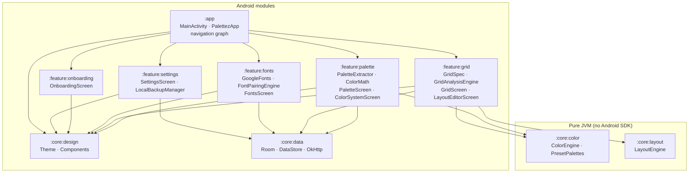

# Palettez — Architecture & Module Structure

> **Status:** Single-module monolith (`:app`) with package-level separation mirroring the target Gradle module structure. The package layout is intentional and designed for a future Gradle split with minimal code movement.

---

## Current Package Structure

```
app/src/main/java/app/palettez/
│
├── color/                        → future :core:color
│   ├── ColorEngine.kt            ✅ PURE  — zero Android imports
│   └── PresetPalettes.kt         ✅ PURE  — zero Android imports
│
├── layout/                       → future :core:layout
│   └── LayoutEngine.kt           ✅ PURE  — zero Android imports
│
├── palette/                      → future :feature:palette + :core:color Android layer
│   ├── ColorMath.kt              ✅ PURE  — zero Android imports (kotlin.math only)
│   ├── PaletteExtractor.kt       🤖 ANDROID — android.graphics.Bitmap (by design)
│   ├── ColorSystemScreen.kt      🤖 ANDROID
│   ├── ColorPresentationDialog.kt 🤖 ANDROID
│   ├── ColorPresentationRenderer.kt 🤖 ANDROID
│   ├── PaletteScreen.kt          🤖 ANDROID
│   ├── PaletteViewModel.kt       🤖 ANDROID
│   ├── PresetsScreen.kt          🤖 ANDROID
│   ├── RecentPaletteCard.kt      🤖 ANDROID
│   └── RecentPalettesRepository.kt 🤖 ANDROID
│
├── grid/                         → future :feature:grid
│   ├── GridSpec.kt               🤖 ANDROID — android.graphics.{Bitmap,Canvas,Paint,...}
│   ├── GridAnalysisEngine.kt     🤖 ANDROID — android.graphics.Bitmap (operates on pixels)
│   ├── GridScreen.kt             🤖 ANDROID
│   ├── GridLayoutsScreen.kt      🤖 ANDROID
│   ├── GridViewModel.kt          🤖 ANDROID
│   ├── GridAnalysisDialog.kt     🤖 ANDROID
│   ├── LayoutEditorScreen.kt     🤖 ANDROID
│   └── LayoutPreview.kt          🤖 ANDROID
│
├── fonts/                        → future :feature:fonts
│   ├── FontPairingEngine.kt      ✅ PURE  — java.net.URLEncoder only
│   ├── GoogleFonts.kt            🤖 ANDROID
│   ├── FontsScreen.kt            🤖 ANDROID
│   ├── FontsViewModel.kt         🤖 ANDROID
│   └── FontDetailScreen.kt       🤖 ANDROID
│
├── settings/                     → future :feature:settings
│   ├── SettingsData.kt           🤖 ANDROID
│   ├── SettingsScreen.kt         🤖 ANDROID
│   ├── SettingsViewModel.kt      🤖 ANDROID
│   └── LocalBackupManager.kt     🤖 ANDROID
│
├── onboarding/                   → future :feature:onboarding
│   └── OnboardingScreen.kt       🤖 ANDROID
│
├── update/                       → future :core:data or :feature:settings
│   ├── UpdateChecker.kt          🤖 ANDROID
│   ├── UpdateAvailableDialog.kt  🤖 ANDROID
│   ├── WhatsNewDialog.kt         🤖 ANDROID
│   └── WhatsNewRegistry.kt       🤖 ANDROID
│
├── ui/                           → future :core:design
│   ├── PalettezApp.kt            🤖 ANDROID
│   ├── components/               🤖 ANDROID (Compose components)
│   └── theme/                    🤖 ANDROID (Compose theming)
│
├── util/
│   └── Platform.kt               🤖 ANDROID
│
└── MainActivity.kt               🤖 ANDROID
```

### Legend

| Icon | Meaning |
|------|---------|
| ✅ PURE | Zero `import android.*` or `import androidx.*` — safe to move to a pure Kotlin/JVM module |
| 🤖 ANDROID | Has Android/AndroidX imports — must remain in an Android module |

---

## Pure-Engine Files Summary

| File | Imports |
|------|---------|
| `color/ColorEngine.kt` | `kotlin.math.*` only |
| `color/PresetPalettes.kt` | none |
| `layout/LayoutEngine.kt` | `kotlin.math.*` only |
| `palette/ColorMath.kt` | `kotlin.math.*` only |
| `fonts/FontPairingEngine.kt` | `java.net.URLEncoder` only |

> **Note on `PaletteExtractor.kt`:** This file uses `android.graphics.Bitmap` by design. It is the Android-layer adapter that feeds pixel data from the platform into the pure `ColorEngine`. It belongs in the `:feature:palette` module (or a `:core:color-android` bridge module), not `:core:color`.

> **Note on `GridAnalysisEngine.kt`:** This file uses `android.graphics.Bitmap` to access pixel data for grid analysis. Same pattern as `PaletteExtractor` — it is a platform adapter, not a pure engine.

---

## Planned Module Dependency Graph



---

## Why We Are Not Splitting Yet

Creating actual Gradle submodules is a substantial refactor:

1. Each module requires its own `build.gradle.kts`, `AndroidManifest.xml` (for Android modules), and `settings.gradle.kts` inclusion.
2. Hilt component scoping must be re-wired across module boundaries.
3. Navigation graphs must be split or use nested graphs.
4. The build has not been validated end-to-end yet (see `AGENTS.md` — "android/ has never been compiled").

**Decision:** Maintain the package discipline now; extract to real Gradle modules once the monolith builds and passes tests cleanly.

---

## Instructions for the Future Gradle Module Split

### Prerequisites
- The monolith builds and all unit tests pass.
- A CI pipeline is in place (see `android/scripts/check_engine_purity.sh`).

### Step-by-step

1. **Create `:core:color`**
   - `mkdir -p core/color/src/main/java/app/palettez/color`
   - Move `ColorEngine.kt` and `PresetPalettes.kt` into it.
   - Create `core/color/build.gradle.kts` (Kotlin JVM library — no AGP):
     ```kotlin
     plugins { alias(libs.plugins.kotlin.jvm) }
     ```
   - Add `include(":core:color")` to `settings.gradle.kts`.
   - In `:app`'s `build.gradle.kts`: `implementation(project(":core:color"))`.

2. **Create `:core:layout`**
   - Same pattern as `:core:color` for `LayoutEngine.kt`.

3. **Create `:core:design`**
   - Android library module. Move `ui/theme/` and `ui/components/` into it.
   - Needs AGP `com.android.library` plugin.

4. **Create `:core:data`**
   - Android library. Move `RecentPalettesRepository.kt`, `SettingsData.kt`, `UpdateChecker.kt`.
   - Bring in Room, DataStore, OkHttp dependencies here only.

5. **Create feature modules**
   - Android library per feature: `:feature:palette`, `:feature:grid`, `:feature:fonts`, `:feature:onboarding`, `:feature:settings`.
   - Each gets only the screens, ViewModels, and feature-local utilities for that feature.
   - Add appropriate `api`/`implementation` dependencies on `core:*` modules.

6. **Slim down `:app`**
   - Keep only `MainActivity.kt`, `PalettezApp.kt`, the top-level nav graph, and Hilt wiring.
   - Replace moved source with `implementation(project(":feature:*"))` dependencies.

7. **Re-run CI purity check**
   ```
   bash android/scripts/check_engine_purity.sh
   ```
   It must still pass against the new locations.

---

## CI Purity Check

A script at [`android/scripts/check_engine_purity.sh`](../android/scripts/check_engine_purity.sh) enforces that `ColorEngine.kt` and `LayoutEngine.kt` remain free of Android imports. Run it in CI on every pull request.

```
bash android/scripts/check_engine_purity.sh
```

Exits `0` on success, `1` on violation.
